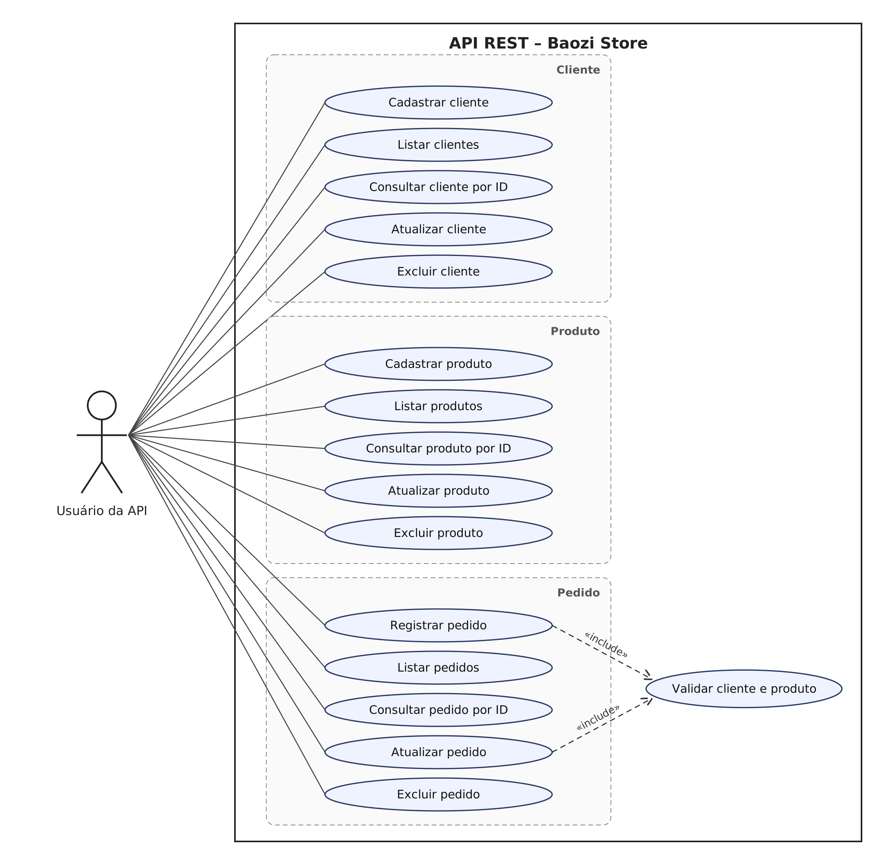

# Baozi Store – API REST

API REST para o controle básico da **Baozi Store**, uma pequena loja de pãozinho chinês (baozi).
Permite cadastrar clientes e produtos e registrar pedidos em que um cliente compra um produto em determinada quantidade.

Trabalho da disciplina **Desenvolvimento Web Back-End** (UNINTER).

## Tecnologias

- Java 21 (compatível com JDK 21 a 26)
- Spring Boot 4.1 (Spring MVC, Spring Data JPA, Bean Validation)
- Hibernate 7
- MySQL 8.4 (via Docker Compose)
- H2 (somente nos testes automatizados)
- JUnit 5 + MockMvc
- Postman

## Arquitetura

O projeto segue o padrão MVC do Spring, com uma camada de serviço entre os controllers e os repositórios:

```
Cliente HTTP (Postman)
        │  JSON
        ▼
controller  →  service  →  repository  →  MySQL
   (REST)      (regras)     (Spring Data JPA)
        ▲           │
        └── model / dto
```

```
src/main/java/br/com/baozistore
├── BaoziStoreApplication.java   # classe principal
├── model/                       # entidades JPA (Cliente, Produto, Pedido)
├── repository/                  # interfaces Spring Data JPA
├── service/                     # regras de negócio e transações
├── controller/                  # endpoints REST
├── dto/                         # contratos de entrada/saída do Pedido
└── exception/                   # exceções e tratamento global de erros
```

## Modelo de dados

| Tabela    | Coluna          | Tipo Java    | Observação                          |
|-----------|-----------------|--------------|-------------------------------------|
| `cliente` | `id`            | `Long`       | PK, auto incremento                 |
|           | `nome`          | `String`     | obrigatório, até 100 caracteres     |
|           | `cliente_desde` | `LocalDate`  | data atual se não for informada     |
| `produto` | `id`            | `Long`       | PK, auto incremento                 |
|           | `nome`          | `String`     | obrigatório, até 100 caracteres     |
|           | `preco`         | `BigDecimal` | obrigatório, maior que zero         |
|           | `estoque`       | `Boolean`    | `true` = disponível para venda      |
| `pedido`  | `id`            | `Long`       | PK, auto incremento                 |
|           | `cliente_id`    | `Long`       | FK → `cliente.id`                   |
|           | `produto_id`    | `Long`       | FK → `produto.id`                   |
|           | `quantidade`    | `Integer`    | obrigatório, maior que zero         |

Um cliente faz vários pedidos e um produto é vendido em vários pedidos (relacionamentos 1:N).

## Endpoints

| Método | Rota             | Descrição                  | Sucesso |
|--------|------------------|----------------------------|---------|
| POST   | `/clientes`      | Cadastra um cliente        | 201     |
| GET    | `/clientes`      | Lista todos os clientes    | 200     |
| GET    | `/clientes/{id}` | Consulta cliente por ID    | 200     |
| PUT    | `/clientes/{id}` | Atualiza um cliente        | 200     |
| DELETE | `/clientes/{id}` | Exclui um cliente          | 204     |
| POST   | `/produtos`      | Cadastra um produto        | 201     |
| GET    | `/produtos`      | Lista todos os produtos    | 200     |
| GET    | `/produtos/{id}` | Consulta produto por ID    | 200     |
| PUT    | `/produtos/{id}` | Atualiza um produto        | 200     |
| DELETE | `/produtos/{id}` | Exclui um produto          | 204     |
| POST   | `/pedidos`       | Registra um pedido         | 201     |
| GET    | `/pedidos`       | Lista todos os pedidos     | 200     |
| GET    | `/pedidos/{id}`  | Consulta pedido por ID     | 200     |
| PUT    | `/pedidos/{id}`  | Atualiza um pedido         | 200     |
| DELETE | `/pedidos/{id}`  | Exclui um pedido           | 204     |

### Exemplos

`POST /clientes`

```json
{ "nome": "Maria", "clienteDesde": "2026-10-12" }
```

`POST /produtos`

```json
{ "nome": "Baozi de Porco", "preco": 7.50, "estoque": true }
```

`POST /pedidos`

```json
{ "clienteId": 1, "produtoId": 1, "quantidade": 6 }
```

Resposta (`201 Created`):

```json
{
  "id": 1,
  "clienteId": 1,
  "clienteNome": "Maria",
  "produtoId": 1,
  "produtoNome": "Baozi de Porco",
  "quantidade": 6,
  "valorTotal": 45.00
}
```

### Erros

Os erros seguem o formato *Problem Details* (RFC 9457):

| Situação                                         | Status |
|--------------------------------------------------|--------|
| Campos inválidos ou JSON malformado              | 400    |
| ID inexistente                                   | 404    |
| Excluir cliente ou produto que possui pedidos    | 409    |
| Pedido de produto sem estoque                    | 422    |

```json
{
  "type": "about:blank",
  "title": "Dados inválidos",
  "status": 400,
  "detail": "Um ou mais campos estão inválidos",
  "instance": "/clientes",
  "erros": { "nome": "nome é obrigatório" }
}
```

## Como executar

Pré-requisitos: JDK 21+ e Docker. O Maven não precisa estar instalado (o projeto usa o Maven Wrapper).

1. Suba o MySQL:

   ```bash
   docker compose up -d
   ```

2. Inicie a aplicação:

   ```bash
   ./mvnw spring-boot:run        # Linux/macOS
   .\mvnw.cmd spring-boot:run    # Windows
   ```

3. A API fica disponível em `http://localhost:8080`.

As tabelas são criadas automaticamente pelo Hibernate. Para usar outro MySQL, defina as variáveis
`DB_URL`, `DB_USERNAME` e `DB_PASSWORD`.

## Testes

```bash
./mvnw test
```

Os testes de integração usam H2 em memória, então não dependem do Docker.

## Postman

Importe `postman/baozi-store.postman_collection.json`. As requisições de criação guardam o ID gerado
em variáveis da collection (`clienteId`, `produtoId`, `pedidoId`), usadas pelas demais.

## Diagrama de caso de uso


